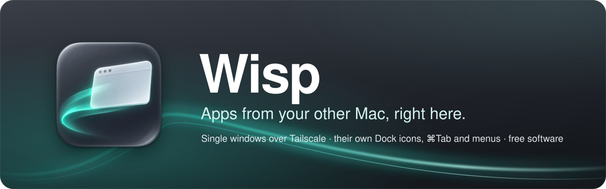
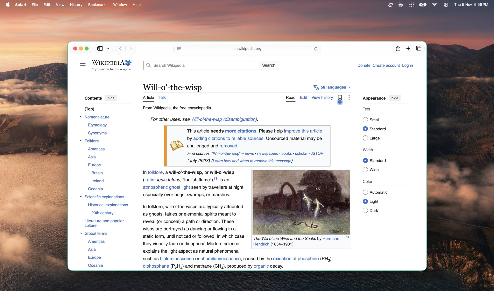
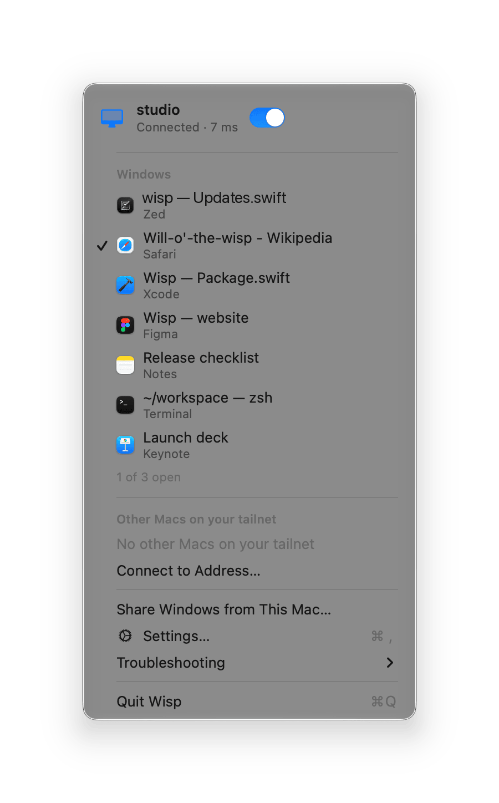
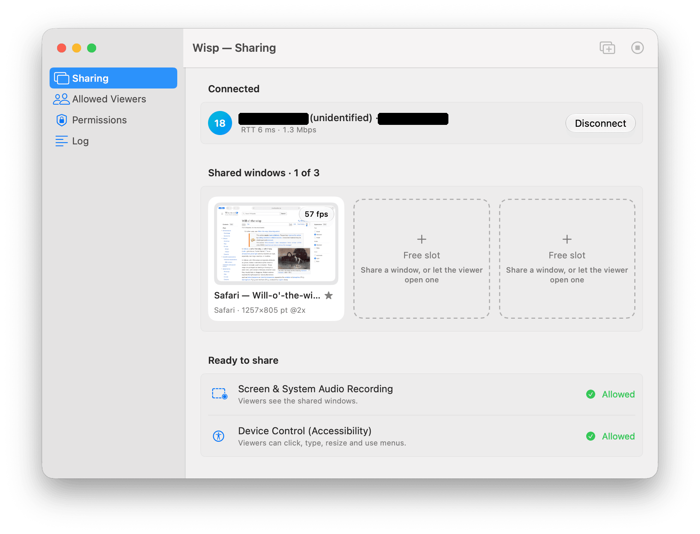
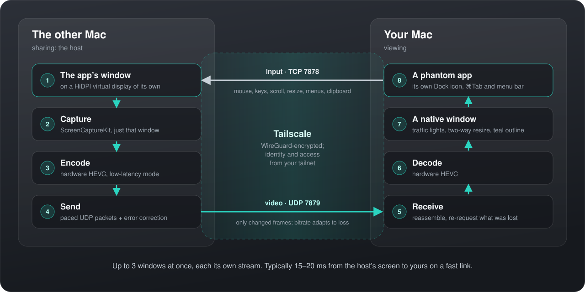

  

  
  
  
  

**Wisp brings single windows from another Mac to yours, over [Tailscale](https://tailscale.com).**
Each remote app turns up as an app of its own: its icon (with a small teal badge) in the Dock and
⌘Tab, its menus in the menu bar, its windows with native title bars that you move, resize and type
into as if the app ran here. Only the windows you open are sent, so it stays fast even across
continents.

> Wisp is experimental: it relies on a private macOS API and comes with no warranty ([risks](#security-and-privacy)).

  

## Install

1. Download **[Wisp for macOS](https://github.com/pier20-ai/wisp/releases/latest)** (the `.dmg`),
   open it, and drag Wisp to Applications.
2. Do the same on the other Mac.

Wisp lives in the menu bar and keeps itself up to date. Building it yourself is described in
[docs/development.md](docs/development.md).

## Requirements

- **Two Macs** with macOS 14 or later.
- **[Tailscale](https://tailscale.com/download)** on both, signed in to the same tailnet.

That's all: no accounts, passwords, pairing or port forwarding. Tailscale encrypts the connection
and tells Wisp who is on the other end.

## Getting started

**On the Mac with the apps**, click Wisp in the menu bar, choose **Share Windows from This Mac…**
and give Wisp the two permissions it asks for: **Screen Recording**, to see windows, and
**Accessibility**, so you can click and type in them.

**On your Mac**, click Wisp in the menu bar. The other Mac is listed as *Sharing*: choose it, then
choose a window.

  
  &nbsp;
  

## Using remote apps

- **They're apps of their own.** Each remote app gets a Dock icon, a place in ⌘Tab and the Window
  menu, and its real menu bar: choosing a menu item chooses it on the other Mac. Keep one in the
  Dock and it reconnects when you open it.
- **The windows behave like local ones.** Drag the title bar, resize from any edge, go full screen;
  the window on the other Mac follows. New windows the app opens (⌘N, a dialog) come along by
  themselves, and Open and Save panels appear over the window they belong to. A thin teal outline
  marks what's remote.
- **Your keyboard goes to the remote app**, shortcuts included, except ⌘Q and ⌘H, which quit or
  hide it here and leave the app running there. The red button closes the window on the
  other Mac; ⌥-click it to just stop viewing.
- **The clipboard is shared** both ways: text, rich text and images (not files). Items a password
  manager marks as secret are never sent.
- **Up to 3 windows at once**, each streamed on its own.

## How it works

  

- Each shared window is moved onto a **virtual display of its own** on the host, HiDPI and sized
  to your screen, so text is sharp, windows never overlap, and a Mac without a monitor works too.
- Video is **hardware HEVC in low-latency mode**, sent only when something changes, with forward
  error correction and selective resends so a lost packet rarely costs a frame.
- On your Mac, a small generated **phantom app** per remote app owns its windows, which is what
  makes the Dock, ⌘Tab, Mission Control and the menu bar treat it as a real app.

The design, the protocol and the measurements behind them are in
[docs/multi-window.md](docs/multi-window.md).

## Security and privacy

- **Anyone on your tailnet can connect by default**, and whoever connects can control the shared
  windows (a Terminal window included). To narrow it, list the people allowed under Settings ›
  **Allowed Viewers**, or limit TCP 7878 and UDP 7879 with
  [Tailscale ACLs](https://tailscale.com/kb/1018/acls). Connections from outside Tailscale are
  refused.
- **The clipboard crosses to the other Mac** while you're connected. Turn it off in Settings on
  either Mac if that matters.
- **Private API.** The virtual displays use Apple's undocumented `CGVirtualDisplay`, which a macOS
  update can break. An early version once hung the host's WindowServer, logging everyone out;
  that's fixed, but there are no guarantees.
- **Updates** come from this repository's releases, checked once a day and verified with an EdDSA
  signature as well as Apple's notarization. Turn the check off in Settings › Troubleshooting.

## Limits

- The host must be unlocked with its user session on screen: while it's locked, input goes to the
  lock screen. Wisp keeps it from idling into the lock while you're connected.
- One viewer per host, up to 3 windows (an M4 Mac mini's encoder limit), no audio, no file
  copy-paste. System prompts on the host (permission requests, AutoFill) have to be answered
  there.

## Troubleshooting

Menu bar › **Troubleshooting** › **Copy Diagnostics** puts a report on the clipboard to paste into
an [issue](https://github.com/pier20-ai/wisp/issues): versions, permissions, settings and the end
of the log, with other people's logins replaced by a hash. The common problems, and where the logs
are, are in [docs/troubleshooting.md](docs/troubleshooting.md).

## Free software

Wisp is [free software](https://www.gnu.org/philosophy/free-sw.en.html): you can use, study, share
and change it under the terms of the [GNU General Public License](LICENSE), version 3 or later. It
comes with no warranty and no support. If it doesn't do what you need, change it:
[docs/development.md](docs/development.md) covers building, testing and releasing, and
[AGENTS.md](AGENTS.md) is a map of the code for you and your coding agent. Third-party credits are
in [THIRD-PARTY-NOTICES.md](THIRD-PARTY-NOTICES.md).

Not affiliated with Apple or Tailscale.
